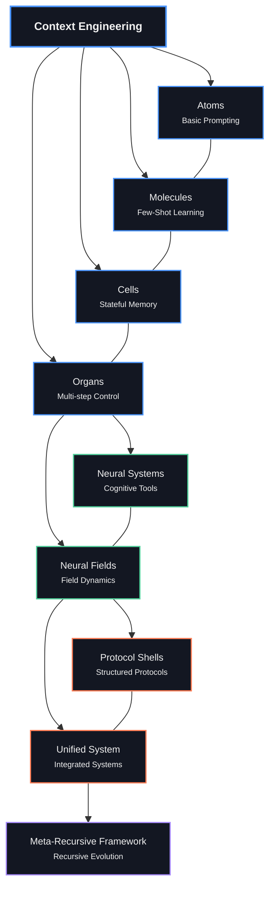

> 原文：[00_foundations/README.md](../../00_foundations/README.md)
> 术语对照：[GLOSSARY.md](../GLOSSARY.md) ｜ 阅读路径：[LEARNING_PATH.md](../LEARNING_PATH.md)
# 基础

> *从原子到统一场：上下文工程（Context Engineering）的理论支柱*
>
>
> **「秩序从混沌的相互作用中涌现。」
> —— 伊利亚·普里高津**

## [学习将上下文可视化为语义网络与场](https://claude.ai/public/artifacts/6a078ba1-7941-43ef-aab1-bad800a3e10c)

## 概览

`00_foundations` 目录包含上下文工程的核心理论基础，从基础的提示概念逐步推进到高级统一场论。每个模块都建立在前序模块之上，形成一个全面的框架，用于理解与操纵大语言模型中的上下文。

```
                    Neural Fields
                         ▲
                         │
                    ┌────┴────┐
                    │         │
              ┌─────┴─┐     ┌─┴─────┐
              │       │     │       │
        ┌─────┴─┐   ┌─┴─────┴─┐   ┌─┴─────┐
        │       │   │         │   │       │
   ┌────┴───┐ ┌─┴───┴──┐ ┌────┴───┴┐ ┌────┴───┐
   │Atoms   │ │Molecules│ │Cells    │ │Organs  │
   └────────┘ └─────────┘ └─────────┘ └────────┘
      Basic     Few-shot    Stateful    Multi-step
    Prompting    Learning    Memory      Control
```
> 图：从原子到神经场的层级结构 —— Neural Fields


## 生物学隐喻

我们的方法围绕一个生物学隐喻构建，为理解上下文工程日益增长的复杂性提供了一个直观框架：

| 层级 | 隐喻 | 上下文工程概念 |
|-------|----------|------------------------------|
| 1 | **原子（atom）** | 基础指令与提示词 |
| 2 | **分子（molecule）** | 少样本示例与演示 |
| 3 | **细胞（cell）** | 有状态记忆与对话 |
| 4 | **器官（organ）** | 多步骤应用与工作流 |
| 5 | **神经系统** | 认知工具与心智模型 |
| 6 | **神经场** | 连续语义景观 |

随着我们逐层推进，我们从离散、静态的方法走向更连续、动态且涌现的系统。

## 模块进阶

### 生物学基础（原子 → 器官）

1. [**01_atoms_prompting.md**](./01_atoms_prompting.md)
   - 基础提示技术
   - 原子指令与约束
   - 直接提示词工程

2. [**02_molecules_context.md**](./02_molecules_context.md)
   - 少样本学习
   - 演示与示例
   - 上下文窗口（context window）与格式化

3. [**03_cells_memory.md**](./03_cells_memory.md)
   - 对话状态
   - 记忆机制
   - 信息持久化

4. [**04_organs_applications.md**](./04_organs_applications.md)
   - 多步骤工作流
   - 控制流与编排
   - 复杂应用

### 认知扩展

5. [**05_cognitive_tools.md**](./05_cognitive_tools.md)
   - 心智模型与框架
   - 推理模式
   - 结构化思维

6. [**06_advanced_applications.md**](./06_advanced_applications.md)
   - 真实世界实现策略
   - 特定领域应用
   - 集成模式

7. [**07_prompt_programming.md**](./07_prompt_programming.md)
   - 类代码提示词结构
   - 提示词中的算法思维
   - 结构化推理

### 场论基础

8. [**08_neural_fields_foundations.md**](./08_neural_fields_foundations.md)
   - 作为连续场的上下文
   - 场的属性与动力学
   - 向量空间表示

9. [**09_persistence_and_resonance.md**](./09_persistence_and_resonance.md)
   - 语义持久化机制
   - 语义模式之间的共振
   - 场的稳定性与演化

10. [**10_field_orchestration.md**](./10_field_orchestration.md)
    - 协调多个场
    - 场交互与边界
    - 复杂场架构

### 高级理论框架

11. [**11_emergence_and_attractor_dynamics.md**](./11_emergence_and_attractor_dynamics.md)
    - 上下文场中的涌现属性
    - 吸引子的形成与演化
    - 语义空间中的自组织

12. [**12_symbolic_mechanisms.md**](./12_symbolic_mechanisms.md)
    - 大语言模型中涌现的符号处理
    - 符号抽象与归纳
    - 机制可解释性

13. [**13_quantum_semantics.md**](./13_quantum_semantics.md)
    - 依赖观察者的意义
    - 非经典上下文性
    - 受量子启发的语义模型

14. [**14_unified_field_theory.md**](./14_unified_field_theory.md)
    - 场、符号与量子视角的整合
    - 多视角问题解决
    - 上下文工程的统一框架

## 可视化学习路径

```
┌─────────────────────────────────────────────────────────────────────────┐
│                                                                         │
│  FOUNDATIONS                        FIELD THEORY            UNIFICATION │
│                                                                         │
│  ┌───────┐ ┌───────┐ ┌───────┐     ┌───────┐ ┌───────┐     ┌───────┐   │
│  │Atoms  │ │Cells  │ │Cogni- │     │Neural │ │Emerge-│     │Unified│   │
│  │Mole-  │ │Organs │ │tive   │     │Fields │ │nce &  │     │Field  │   │
│  │cules  │ │       │ │Tools  │     │       │ │Attr.  │     │Theory │   │
│  └───┬───┘ └───┬───┘ └───┬───┘     └───┬───┘ └───┬───┘     └───┬───┘   │
│      │         │         │             │         │             │       │
│      │         │         │             │         │             │       │
│      ▼         ▼         ▼             ▼         ▼             ▼       │
│  ┌─────────────────────────┐       ┌───────────────────┐   ┌─────────┐ │
│  │                         │       │                   │   │         │ │
│  │  Traditional Context    │       │  Field-Based      │   │ Unified │ │
│  │      Engineering        │       │  Approaches       │   │Framework│ │
│  │                         │       │                   │   │         │ │
│  └─────────────────────────┘       └───────────────────┘   └─────────┘ │
│                                                                         │
└─────────────────────────────────────────────────────────────────────────┘
```
> 图：从基础到统一的可视化学习路径 —— FOUNDATIONS / FIELD THEORY / UNIFICATION

## 理论视角

我们的基础模块从三个互补的视角处理上下文工程：

```
                        ┌─────────────────┐
                        │                 │
                        │  FIELD VIEW     │
                        │  (Continuous)   │
                        │                 │
                        └─────────┬───────┘
                                  │
                                  │
                    ┌─────────────┴─────────────┐
                    │                           │
       ┌────────────┴────────────┐   ┌──────────┴───────────┐
       │                         │   │                      │
       │   SYMBOLIC VIEW         │   │   QUANTUM VIEW       │
       │   (Mechanistic)         │   │   (Observer-Based)   │
       │                         │   │                      │
       └─────────────────────────┘   └──────────────────────┘
```
> 图：场、符号与量子三种视角 —— FIELD VIEW / SYMBOLIC VIEW / QUANTUM VIEW

### 场视角

将上下文视为连续的语义景观，具有以下特征：
- **吸引子**：稳定的语义构型
- **共振**：模式之间的强化
- **持久性**：结构随时间的存续
- **边界**：语义区域之间的界面

### 符号视角

揭示大语言模型如何通过以下方式实现符号处理：
- **符号抽象**：将词元（token）转换为抽象变量
- **符号归纳**：在变量之上识别模式
- **检索**：将变量映射回具体词元

### 量子视角

将意义建模为类量子现象，具有以下特征：
- **叠加**：同时存在多种潜在意义
- **测量**：解释使叠加态「坍缩」
- **非交换性**：上下文操作的顺序至关重要
- **上下文性**：意义中的非经典关联

## 关键概念图谱

```
                                ┌──────────────────┐
                                │                  │
                                │  Context Field   │
                                │                  │
                                └────────┬─────────┘
                                         │
                 ┌────────────────┬──────┴───────┬────────────────┐
                 │                │              │                │
        ┌────────┴────────┐ ┌─────┴─────┐ ┌──────┴──────┐ ┌───────┴───────┐
        │                 │ │           │ │             │ │               │
        │    Resonance    │ │Persistence│ │  Attractors │ │  Boundaries   │
        │                 │ │           │ │             │ │               │
        └─────────────────┘ └───────────┘ └─────────────┘ └───────────────┘
                                          │
                                 ┌────────┴──────────┐
                                 │                   │
                       ┌─────────┴──────┐   ┌────────┴──────────┐
                       │                │   │                   │
                       │    Emergence   │   │ Symbolic Mechanisms│
                       │                │   │                   │
                       └────────────────┘   └───────────────────┘
                                                      │
                                           ┌──────────┴──────────┐
                                           │                     │
                                  ┌────────┴────────┐   ┌────────┴─────────┐
                                  │                 │   │                  │
                                  │    Abstraction  │   │     Induction    │
                                  │                 │   │                  │
                                  └─────────────────┘   └──────────────────┘
```
> 图：上下文场关键概念图谱 —— Context Field

## 学习方法

每个模块遵循以下教学原则：

1. **多视角学习**：概念从具体、数值与抽象三个视角呈现
2. **直觉优先**：在正式定义之前，通过物理类比与可视化建立直觉
3. **渐进复杂度**：每个模块建立在前序模块之上，逐步提升复杂度
4. **实践落地**：理论概念与实际实现相连接
5. **苏格拉底式提问**：反思性问题促进更深入的理解

## 阅读顺序

对于初学者，我们建议按照模块的编号顺序（01 → 14）阅读。不过，你也可以根据兴趣选择不同的路径：

### 面向提示词工程师
1 → 2 → 3 → 4 → 7 → 5

### 面向场论爱好者
8 → 9 → 10 → 11 → 14

### 面向符号机制爱好者
12 → 13 → 14

### 面向全面理解
遵循从 1 到 14 的完整顺序

## 与其他目录的集成

本目录中的理论基础支撑着仓库其余部分的实践实现：

- **10_guides_zero_to_hero**：实现这些概念的实践笔记本
- **20_templates**：基于这些基础的可复用组件
- **30_examples**：这些原则的真实世界应用
- **40_reference**：拓展这些概念的详细参考资料
- **60_protocols**：实现场论概念的协议壳
- **70_agents**：利用这些基础的智能体（agent）实现
- **80_field_integration**：集成所有理论方法的完整系统

## 后续步骤

在探索完这些基础之后，我们建议：

1. 尝试 `10_guides_zero_to_hero/` 中的实践笔记本
2. 试验 `20_templates/` 中的模板
3. 研读 `30_examples/` 中的完整示例
4. 探索 `60_protocols/` 中的协议壳

## 基于场的学习可视化

```
                        CONTEXT FIELD MAP
            ┌─────────────────────────────────────────┐
            │                                         │
            │    ◎                                    │
            │   Atoms                       ◎         │
            │                            Unified      │
            │                             Field       │
            │                                         │
            │         ◎                               │
            │      Molecules       ◎                  │
            │                  Quantum                │
            │                 Semantics               │
            │                                         │
            │   ◎                                     │
            │  Cells          ◎        ◎              │
            │             Attractors  Symbolic        │
            │                         Mechanisms      │
            │                                         │
            │       ◎                                 │
            │     Organs     ◎                        │
            │              Fields                     │
            │                                         │
            └─────────────────────────────────────────┘
               Attractors in the Learning Landscape
```
> 图：上下文场学习地图 —— CONTEXT FIELD MAP

我们框架中的每个概念都充当语义景观中的一个吸引子，引导你的理解走向对上下文工程稳定而连贯的解读。

---

*「世界上最不可理解的事情，恰恰在于它是可以理解的。」*
—— Albert Einstein
