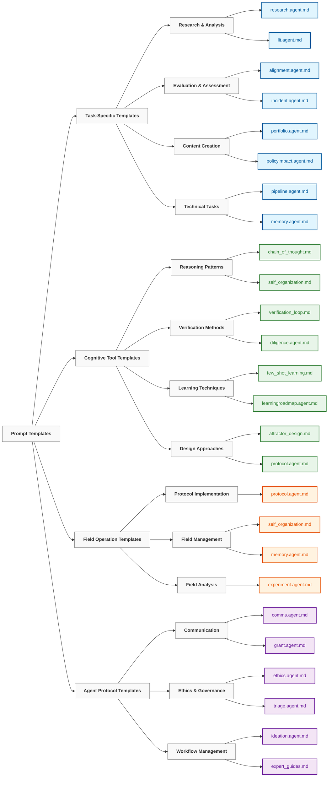

> 原文：[20_templates/PROMPTS/README.md](../../../20_templates/PROMPTS/README.md)
> 术语对照：[GLOSSARY.md](../../GLOSSARY.md) ｜ 阅读路径：[LEARNING_PATH.md](../../LEARNING_PATH.md)
# 上下文工程（Context Engineering）提示词（Prompt）模板

> 「语言的多样性并非符号和声音的多样性，而是世界观的多样性。」——**威廉·冯·洪堡**

## 概述

`PROMPTS` 目录包含面向特定应用、可直接使用的专业提示词模板，将上下文工程原理落实到实践中。这些模板超越基础提示词工程（Prompt Engineering），融入结构化上下文管理（Context Management）、场（Field）论概念和递归（Recursive）改进机制。

每个模板均遵循标准化格式，便于复用、调整，以及与其他上下文工程组件组合。

## 提示词模板结构

```
┌──────────────────────────────────────────────────────────┐
│                      META SECTION                        │
│ Version, author, purpose, context requirements           │
├──────────────────────────────────────────────────────────┤
│                  STRUCTURE SECTION                       │
│ Template structure, parameters, expected inputs/outputs  │
├──────────────────────────────────────────────────────────┤
│                   CONTEXT SECTION                        │
│ Field setup, attractors, residue tracking, coherence     │
├──────────────────────────────────────────────────────────┤
│                    PROMPT SECTION                        │
│ Actual prompt template with parameter placeholders       │
├──────────────────────────────────────────────────────────┤
│                  WORKFLOW SECTION                        │
│ Multi-stage process flow, feedback loops                 │
├──────────────────────────────────────────────────────────┤
│                   EXAMPLES SECTION                       │
│ Sample use cases, inputs/outputs, variations             │
└──────────────────────────────────────────────────────────┘
```
> 图：提示词模板的六个标准章节 —— Prompt Template Structure

## 提示词类别

提示词模板根据应用领域和复杂度分为以下类别：




### 任务专用模板

为特定应用和领域设计的模板：

| 模板 | 用途 | 主要特性 |
|----------|---------|-------------|
| [`alignment.agent.md`](./alignment.agent.md) | AI 安全与对齐评估（Evaluation） | 价值追踪、产物分解、偏差检测 |
| [`research.agent.md`](./research.agent.md) | 文献综述与综合 | 引文追踪、主张验证、洞见提取 |
| [`incident.agent.md`](./incident.agent.md) | 事后事件分析 | 根因识别、多因素分析、偏差缓解 |
| [`lit.agent.md`](./lit.agent.md) | 文学分析 | 主题检测、人物映射、叙事模式（Pattern）识别 |

### 认知工具（Cognitive Tool）模板

实现特定推理模式的模板：

| 模板 | 用途 | 主要特性 |
|----------|---------|-------------|
| [`chain_of_thought.md`](./chain_of_thought.md) | 逐步推理 | 透明的决策追踪、假设标记、分支管理 |
| [`verification_loop.md`](./verification_loop.md) | 自验证工作流 | 错误检测、假设验证、反例生成 |
| [`few_shot_learning.md`](./few_shot_learning.md) | 从示例中学习 | 模式抽象、泛化映射、边界案例生成 |
| [`attractor_design.md`](./attractor_design.md) | 语义吸引子（Attractor）创建 | 场稳定性、持续主题发展、共振（Resonance）优化 |

### 场操作模板

实现神经场（Neural Field）概念的模板：

| 模板 | 用途 | 主要特性 |
|----------|---------|-------------|
| [`protocol.agent.md`](./protocol.agent.md) | 场协议（Protocol）编排（Orchestration） | 协议壳（Shell）执行、操作排序、场测量 |
| [`self_organization.md`](./self_organization.md) | 促进涌现（Emergence）模式 | 吸引子形成、边界消融、共振放大 |
| [`memory.agent.md`](./memory.agent.md) | 长期记忆（Long-Term Memory）管理 | 残差（Residue）追踪、压缩技术、检索（Retrieval）优化 |

### 智能体（Agent）协议模板

用于实现自主智能体的模板：

| 模板 | 用途 | 主要特性 |
|----------|---------|-------------|
| [`comms.agent.md`](./comms.agent.md) | 沟通管理 | 受众分析、消息策略、语气校准 |
| [`diligence.agent.md`](./diligence.agent.md) | 深入调查 | 全面分析、来源交叉验证、假设检验 |
| [`ethics.agent.md`](./ethics.agent.md) | 伦理决策 | 价值框架、利益相关方分析、原则应用 |
| [`triage.agent.md`](./triage.agent.md) | 优先级评估 | 影响评估、紧迫性评估、资源分配 |

## 使用模式

### 基础模板应用

以最简单的形式使用提示词模板：

```python
import re

# Load template
with open('PROMPTS/research.agent.md', 'r') as f:
    template = f.read()

# Replace parameters
filled_template = template.replace('{{RESEARCH_TOPIC}}', 'climate change mitigation')
                         .replace('{{FOCUS_AREA}}', 'carbon capture technologies')
                         .replace('{{TIME_FRAME}}', 'last 5 years')

# Use with LLM
response = llm.generate(filled_template)
```

### 高级集成

对于更复杂的应用，可与其他上下文工程组件集成：

```python
from templates.prompt_program_template import PromptProgram
from templates.field_protocol_shells import ProtocolShell

# Load prompt template
with open('PROMPTS/protocol.agent.md', 'r') as f:
    template = f.read()
    
# Extract context section
context_section = re.search(r'## Context\s+```yaml\s+(.*?)\s+```', 
                          template, re.DOTALL).group(1)
                          
# Parse context configuration
context_config = yaml.safe_load(context_section)

# Create field protocol
protocol = ProtocolShell.from_dict(context_config.get('protocol', {}))

# Create prompt program with the template
program = PromptProgram(
    description=context_config.get('description', ''),
    template=template
)

# Execute integrated system
result = program.execute_with_protocol(protocol, {'input': user_query})
```

### 模板定制

可针对具体用例定制模板：

1. **参数调整**：按具体需求修改占位符的值
2. **章节增强**：添加领域专用章节
3. **上下文集成**：连接知识库或检索系统
4. **工作流修改**：根据具体任务调整流程
5. **场调优**：调整吸引子强度和场参数

## 实现原则

本目录中的全部提示词模板均遵循以下核心原则：

1. **分层结构**：从基础提示词逐步构建复杂系统
2. **参数化**：通过清晰的参数接口支持定制
3. **上下文感知**：明确管理上下文与场动力学
4. **工作流集成**：定义明确的流程和交互模式
5. **提供示例**：用具体示例展示有效用法
6. **文档说明**：全面解释设计与应用
7. **模块化**：能够与其他模板和组件组合

## 开发指南

创建新提示词模板时，请遵循以下指南：

1. 使用标准化章节结构
2. 清楚描述所有参数
3. 至少包含三个使用示例
4. 明确上下文要求和场动力学
5. 实现适当的工作流过程
6. 在不同模型和场景中测试
7. 遵循命名约定：`[domain].[purpose].md`

## 学习路径

对于上下文工程提示词的初学者，建议按以下顺序学习：

1. 从基础任务专用模板开始
2. 转向认知工具模板，学习推理模式
3. 探索场操作模板，掌握高级上下文动力学
4. 试用自主系统的智能体协议模板

## 相关资源

- 基础上下文结构见 [`../minimal_context.yaml`](../minimal_context.yaml)
- 程序结构见 [`../prompt_program_template.py`](../prompt_program_template.py)
- 场操作见 [`../field_protocol_shells.py`](../field_protocol_shells.py)
- 完整实现见 [`../../30_examples/`](../../30_examples/)

---

*随着上下文工程技术的发展，本目录会不断扩充新模板。欢迎通过拉取请求贡献。*
