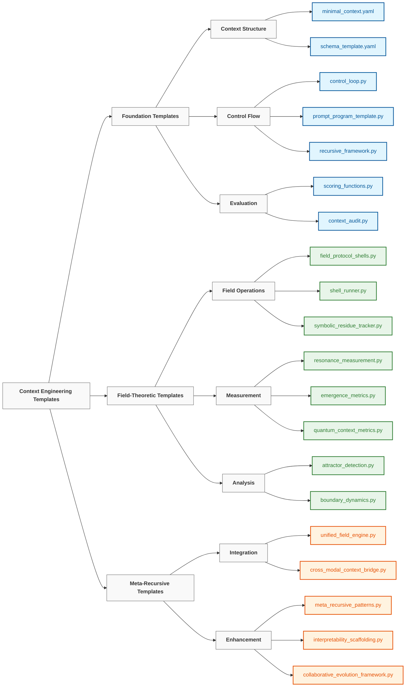

> 原文：[20_templates/README.md](../../20_templates/README.md)
> 术语对照：[GLOSSARY.md](../GLOSSARY.md) ｜ 阅读路径：[LEARNING_PATH.md](../LEARNING_PATH.md)
# 上下文工程模板

> “如果我们拒绝在语言的牢笼中思考，就不得不停止思考。” — **Friedrich Nietzsche**

## 概览

`20_templates` 目录提供一组可复用、可组合的组件，用于在广泛的应用中落实上下文工程原则。每个模板封装一种特定模式或机制，可通过组合构建复杂的上下文管理系统。

这些模板遵循复杂度递进模型，从基本结构起步，逐渐构建高级场论实现：

```
atoms → molecules → cells → organs → neural systems → neural fields
  │        │         │        │             │              │
single    few-     memory/   multi-    cognitive tools   fields +
prompt    shot     agents    agents    prompt programs   persistence
```

## 模板类别



### 基础模板

基础上下文工程的基本构件：

| 模板 | 用途 | 用法 |
|----------|---------|-------|
| [`minimal_context.yaml`](./minimal_context.yaml) | 用于通用大语言模型交互的轻量模板 | 任何上下文工程项目的起点 |
| [`schema_template.yaml`](./schema_template.yaml) | 标准化上下文格式的数据结构定义 | 确保上下文表示一致 |
| [`control_loop.py`](./control_loop.py) | 迭代处理上下文的框架 | 实现循环优化工作流 |
| [`prompt_program_template.py`](./prompt_program_template.py) | 复杂推理的结构化提示词模式 | 创建类似代码的推理结构 |
| [`scoring_functions.py`](./scoring_functions.py) | 上下文质量的评估指标 | 定量评估上下文有效性 |

### 场论模板

实现场论原理的高级神经场组件：

| 模板 | 用途 | 用法 |
|----------|---------|-------|
| [`field_protocol_shells.py`](./field_protocol_shells.py) | 场操作模板 | 实现标准化场操作协议 |
| [`neural_field_context.yaml`](./neural_field_context.yaml) | 基于神经场的上下文配置 | 建立连续语义场 |
| [`resonance_measurement.py`](./resonance_measurement.py) | 衡量场协调性的工具 | 量化语义关系 |
| [`attractor_detection.py`](./attractor_detection.py) | 识别语义吸引子的技术 | 寻找上下文场中的稳定模式 |
| [`symbolic_residue_tracker.py`](./symbolic_residue_tracker.py) | 监测符号片段的系统 | 跟踪持久信息 |

### 元递归模板

用于自我改进与集成系统的高级模板：

| 模板 | 用途 | 用法 |
|----------|---------|-------|
| [`meta_recursive_patterns.py`](./meta_recursive_patterns.py) | 自我改进模式 | 创建能够自我增强的系统 |
| [`unified_field_engine.py`](./unified_field_engine.py) | 集成多种场操作 | 协调复杂的场交互 |
| [`interpretability_scaffolding.py`](./interpretability_scaffolding.py) | 提升透明度的框架 | 使操作易于理解 |
| [`collaborative_evolution_framework.py`](./collaborative_evolution_framework.py) | 人类与 AI 的协作结构 | 促进有效协作 |
| [`cross_modal_context_bridge.py`](./cross_modal_context_bridge.py) | 多模态集成模式 | 统一跨模态理解 |

## 实施策略

这些模板遵循一致的实施策略，原则如下：

1. **分层方法**：从基础概念逐步构建到高级集成
2. **注重实践**：确保所有理论都有对应的实际实现
3. **模块化设计**：创建可重新组合的组件
4. **复杂度递进**：从简单方案开始，逐步增加复杂能力
5. **强调集成**：关注组件如何协同工作，而不只是独立运作
6. **自我改进**：构建能够自我增强的系统
7. **透明度**：确保操作即使复杂也依然易于理解
8. **协作**：为有效的人类与 AI 协作而设计
9. **模态灵活性**：支持跨不同模态的统一理解

## 使用模式

### 基本模板适配

通过简单的配置更改即可适配模板：

```python
import yaml

# Load the template
with open('minimal_context.yaml', 'r') as f:
    context_template = yaml.safe_load(f)

# Customize for your specific use case
context_template['system']['role'] = "specialized_assistant"
context_template['token_budget'] = 500

# Use the customized template
# ...
```

### 组件组合

组合多个模板以创建复杂系统：

```python
from templates.prompt_program_template import PromptProgram
from templates.field_protocol_shells import ProtocolShell

# Create a prompt program
program = PromptProgram("Solve complex reasoning tasks")
program.add_step("Parse the problem")
program.add_step("Identify relevant concepts")
# ...

# Integrate with protocol shell
protocol = ProtocolShell.from_file("path/to/reasoning.shell")
protocol_program = protocol.create_program(program)

# Execute the integrated system
result = protocol_program.execute(input_data)
```

### 渐进增强

从基础模板开始，逐步增强：

1. 从 `minimal_context.yaml` 开始实现简单交互
2. 使用 `scoring_functions.py` 添加结构化评估
3. 通过 `control_loop.py` 实现迭代优化
4. 使用 `field_protocol_shells.py` 引入场动力学
5. 通过 `meta_recursive_patterns.py` 集成自我改进

## 学习路径

对于上下文工程初学者，建议采用以下学习路径：

```
┌─────────────────┐     ┌──────────────────┐     ┌────────────────┐
│ minimal_context │     │ control_loop +   │     │ field_protocol │
│     .yaml       │────▶│ prompt_program   │────▶│    _shells     │
│                 │     │                  │     │                │
└─────────────────┘     └──────────────────┘     └────────────────┘
         │                                                │
         │                                                │
         ▼                                                ▼
┌─────────────────┐                             ┌────────────────┐
│    scoring_     │◀───────────────────────────▶│  resonance_    │
│   functions     │                             │  measurement   │
│                 │                             │                │
└─────────────────┘                             └────────────────┘
         ▲                                                ▲
         │                                                │
         └────────────────────┐               ┌───────────┘
                              ▼               ▼
                         ┌─────────────────────┐
                         │  meta_recursive_    │
                         │     patterns        │
                         │                     │
                         └─────────────────────┘
```

## 模板开发

创建新模板或修改现有模板时，请遵循以下准则：

1. **保持兼容**：确保新模板与现有模板协同工作
2. **完整记录**：提供清晰的文档和示例
3. **渐进增强**：支持逐步采用和扩展
4. **全面测试**：在不同场景中验证模板
5. **提供默认值**：为所有参数设置合理默认值

## 其他资源

- 理论背景见 [`../00_foundations/`](../00_foundations/)
- 实践教程见 [`../10_guides_zero_to_hero/`](../10_guides_zero_to_hero/)
- 完整实现见 [`../30_examples/`](../30_examples/)
- 详细文档见 [`../40_reference/`](../40_reference/)

---

*本目录持续维护，并随着上下文工程领域的发展不断加入新模板。欢迎通过拉取请求贡献。*
