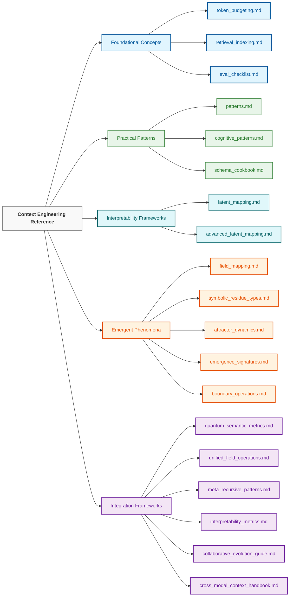

> 原文：[40_reference/README.md](../../40_reference/README.md)
> 术语对照：[GLOSSARY.md](../GLOSSARY.md) ｜ 阅读路径：[LEARNING_PATH.md](../LEARNING_PATH.md)
# 上下文工程：参考文档

> “我们沿着母语所规定的路线剖析自然。”
>
> [**— 本杰明·李·沃尔夫**](https://en.wikipedia.org/wiki/Benjamin_Lee_Whorf)，[**萨皮尔-沃尔夫语言相对论假说之父**](https://en.wikipedia.org/wiki/Linguistic_relativity)
> 
> 
> 语言影响思想，而不是相反的概念
>
> 这在我们的上下文工程领域尤其重要，我们的任务是指导和调试智能体思维

## 概述

欢迎来到上下文工程存储库的参考文档部分。该目录包含综合指南、分类法和技术规范，作为上下文工程实践的理论基础和实践参考。

这些参考材料旨在补充 `10_guides_zero_to_hero` 和 `30_examples` 目录中的更多实践指南，提供对底层概念、模式和框架的更深入了解。

```
┌─────────────────────────────────────────────────────────┐
│                REFERENCE ARCHITECTURE                   │
├─────────────────────────────────────────────────────────┤
│                                                         │
│  FOUNDATIONS → PATTERNS → PHENOMENA → APPLICATIONS      │
│  (Concepts)    (Methods)   (Effects)    (Use Cases)     │
│                                                         │
│  • Understanding the underlying theory                  │
│  • Building a common vocabulary                         │
│  • Establishing evaluation frameworks                   │
│  • Documenting field consensus and open questions       │
│  • Providing design patterns and best practices         │
│                                                         │
└─────────────────────────────────────────────────────────┘
```
> 图：上述过程或结构示意 —— Field mapping

## 如何使用该目录

参考文档分为五个主要类别，以支持不同的学习和应用需求：

1. **基本概念**：支撑上下文工程的核心原则和框架
2. **实用模式**：设计模式、实现模式和方法论
3. **可解释性框架**：理解和可视化人工智能推理的工具和方法
4. **涌现现象**：上下文系统中复杂的涌现特性的记录
5. **集成框架**：将方法组合成综合系统的指南

### 学习路径

对于上下文工程的新手，我们推荐以下学习路径：



## 目录内容

### 基本概念

|文件|描述 |关键应用|
|----------|-------------|------------------|
| **[token_budgeting.md](./token_budgeting.md)** |通过资源分配策略优化词元使用的综合指南| 预算规划、成本优化、下游窗口管理 |
| **[retrieval_indexing.md](./retrieval_indexing.md)** |信息检索系统和索引方法参考| RAG 实现、知识库设计、搜索优化 |
| **[eval_checklist.md](./eval_checklist.md)** | 评估上下文工程系统的方法和标准|质量评估、性能测量、系统验证 |

### 实用模式

|文件|描述 |关键应用|
|----------|-------------|------------------|
| **[模式.md](./patterns.md)** |上下文工程系统通用设计模式|架构设计、方案开发、模式识别 |
| **[认知模式.md](./cognitive_patterns.md)** |增强 AI 认知能力的推理模式库 |推理增强、认知支架、问题解决框架 |
| **[schema_cookbook.md](./schema_cookbook.md)** |结构化信息表示模式设计模式合集 |数据建模、知识表示、信息组织|

### 可解释性框架

|文件|描述 |关键应用|
|----------|-------------|------------------|
| **[latent_mapping.md](./latent_mapping.md)** | AI 潜空间可视化与分析简介 |模型理解、概念映射、表示可视化 |
| **[advanced_latent_mapping.md](./advanced_latent_mapping.md)** |通过潜空间跟踪和分析人工智能推理的先进技术 |电路追踪、残留检测、场突变、荟萃分析 |

### 涌现现象

|文件|描述 |关键应用|
|----------|-------------|------------------|
| **[field_mapping.md](./field_mapping.md)** |语义场可视化和理解指南 | 场理论应用、语义空间导航、概念映射 |
| **[symbolic_residue_types.md](./symbolic_residue_types.md)** |符号残差的分类及其分类|推理分析、偏差检测、可解释性研究 |
| **[attractor_dynamics.md](./attractor_dynamics.md)** |上下文系统中吸引子行为和动态的参考| 吸引力子设计、稳定性工程、语义重力控制|
| **[emergence_signatures.md](./emergence_signatures.md)** |识别和使用紧急模式指南 |紧急财产检测、复杂系统分析、不可预测行为管理 |
| **[边界操作.md](./boundary_operations.md)** |语义场边界管理参考| 场围堵、上下文隔离、边界渗透控制|

### 集成框架

|文件|描述 |关键应用|
|----------|-------------|------------------|
| **[quantum_semantic_metrics.md](./quantum_semantic_metrics.md)** |依赖于观察者的语义解释的度量 |多视角分析、歧义测量、解释框架设计|
| **[unified_field_operations.md](./unified_field_operations.md)** |跨域综合场馆运营指南|跨领域整合、整体系统设计、场域统一 |
| **[meta_recursive_patterns.md](./meta_recursive_patterns.md)** | 自我改进和递归系统的模式 |自我优化、递归增强、元认知框架 |
| **[interpretability_metrics.md](./interpretability_metrics.md)** |系统透明度的指标和方法|透明度测量、可解释性评估、可解释性框架 |
| **[collaborative_evolution_guide.md](./collaborative_evolution_guide.md)** |人机协同开发指南 |伙伴关系设计、共同进化框架、协作智能 |
| **[cross_modal_context_handbook.md](./cross_modal_context_handbook.md)** |多模式集成手册|跨模态系统、统一表示、模态桥接 |

## 潜在映射：理解人工智能推理

潜在映射文档为理解和可视化人工智能推理过程提供了基本框架：

```
┌─────────────────────────────────────────────────────────┐
│               LATENT MAPPING PROGRESSION               │
├─────────────────────────────────────────────────────────┤
│                                                         │
│  FOUNDATIONS       →       ADVANCED TECHNIQUES          │
│  latent_mapping.md         advanced_latent_mapping.md   │
│                                                         │
│  • Basic visualization     • Circuit tracing            │
│  • Concept mapping         • Symbolic residue detection │
│  • Attention patterns      • Shell stacking analysis    │
│  • Simple interventions    • Field mutation techniques  │
│  • Representation analysis • Meta-recursive analysis    │
│                                                         │
└─────────────────────────────────────────────────────────┘
```
> 图：上述过程或结构示意 —— Field mapping

### 从基础到高级潜在映射

潜在映射文档形成了渐进式学习路径：

1. **基础理解** (latent_mapping.md)
   - 学习可视化基本的人工智能思维过程
   - 潜空间中的地图概念表示
   - 了解注意力机制
   - 进行简单的干预

2. **高级分析** (advanced_latent_mapping.md)
   - 追踪神经回路，如电通路
   - 追踪 AI 推理留下的符号残差
   - 堆叠上下文协议壳以理解分层含义
   - 实时变异思维场
   - 执行递归自检

这些文件对于以下方面特别有价值：
- 了解人工智能系统实际上是如何推理的
- 检测偏差和故障模式
- 增强复杂系统的可解释性
- 设计更有效的上下文工程解决方案

## 实施方法论

参考材料支持结构化实施方法：

```
┌─────────────────────────────────────────────────────────┐
│               IMPLEMENTATION WORKFLOW                   │
├─────────────────────────────────────────────────────────┤
│                                                         │
│  1. ANALYZE                                             │
│     ↓                                                   │
│     • Understand system requirements                    │
│     • Define context engineering objectives             │
│     • Identify resource constraints                     │
│                                                         │
│  2. DESIGN                                              │
│     ↓                                                   │
│     • Select appropriate patterns                       │
│     • Define field architecture                         │
│     • Create schema structures                          │
│                                                         │
│  3. IMPLEMENT                                           │
│     ↓                                                   │
│     • Build token budget plan                           │
│     • Develop context structures                        │
│     • Integrate field operations                        │
│                                                         │
│  4. EVALUATE                                            │
│     ↓                                                   │
│     • Apply evaluation checklist                        │
│     • Measure performance metrics                       │
│     • Assess interpretability                           │
│                                                         │
│  5. REFINE                                              │
│     ↓                                                   │
│     • Optimize token allocation                         │
│     • Enhance field dynamics                            │
│     • Implement meta-recursive improvements             │
│                                                         │
└─────────────────────────────────────────────────────────┘
```
> 图：上述过程或结构示意 —— Field mapping

## 应用领域

这些参考材料支持广泛的应用领域：

### 基本应用

- **对话式人工智能**：增强对话系统的连贯性、记忆力和推理能力
- **RAG Systems**：优化外部知识的搜索和整合
- **内容生成**：提高生成内容的质量、风格和连贯性
- **领域适应**：通过最少的微调将模型定制到特定领域

### 高级应用

- **多智能体系统**：设计和编排复杂的智能体交互
- **紧急行为控制**：管理和利用紧急属性
- **基于场的推理**：使用场理论实现复杂的推理框架
- **自我进化系统**：创建通过递归自我修改来改进的系统
- **人工智能可解释性研究**：应用潜在映射技术来理解模型行为

## 从理论到实践

参考文档旨在通过以下方式连接理论和实践：

```
┌─────────────────────────────────────────────────────────┐
│               THEORY-PRACTICE BRIDGE                    │
├─────────────────────────────────────────────────────────┤
│                                                         │
│  CONCEPTUAL          │           PRACTICAL              │
│  UNDERSTANDING       │           APPLICATION            │
│                      │                                  │
│  • Latent space  ───────→ • Visualization tools         │
│    representation    │                                  │
│                      │                                  │
│  • Field theory  ───────→ • Field implementation        │
│                      │     techniques                   │
│                      │                                  │
│  • Symbolic      ───────→ • Residue detection methods   │
│    residue           │                                  │
│                      │                                  │
│  • Emergence     ───────→ • Emergence management        │
│    patterns          │     approaches                   │
│                      │                                  │
│  • Quantum       ───────→ • Multi-perspective           │
│    semantics         │     interpretability             │
│                      │                                  │
└─────────────────────────────────────────────────────────┘
```
> 图：上述过程或结构示意 —— Field mapping

## 贡献指南

本参考目录旨在与上下文工程领域一起成长和发展。欢迎在以下领域做出贡献：

- **新参考文档**：新兴概念的附加参考材料
- **现有文档增强**：对现有文档的扩展、澄清和更新
- **视觉辅助工具**：增强理解的图表、图表和可视化
- **案例研究**：这些参考材料在现实世界问题中的应用记录
- **集成指南**：与其他框架和技术集成的参考

请参阅主存储库 [CONTRIBUTING.md](../../.github/CONTRIBUTING.md) 以获取提交指南。

## 未来的方向

参考资料将在几个关键方向上继续发展：

1. **定量指标**：开发更精确的测量框架
2. **跨模式整合**：扩大多模式上下文工程的覆盖范围
3. **行业特定指南**：不同行业的专业参考资料
4. **可解释性框架**：理解上下文系统的高级方法
5. **形式验证**：形式验证上下文工程系统的方法
6. **符号残差分析**：残留检测和解释技术的进一步发展
7. **递归元分析**：可以分析和改进自身的增强系统框架

---

本自述文件概述了 `40_reference/` 目录中提供的参考资料。有关更多实践指导，请参阅 `10_guides_zero_to_hero/` 目录，有关实际示例，请参阅 `30_examples/` 目录。

请记住，上下文工程既是一门艺术，也是一门科学——这些参考资料提供了科学基础，但有效地应用它们需要实践、实验和创造力。
