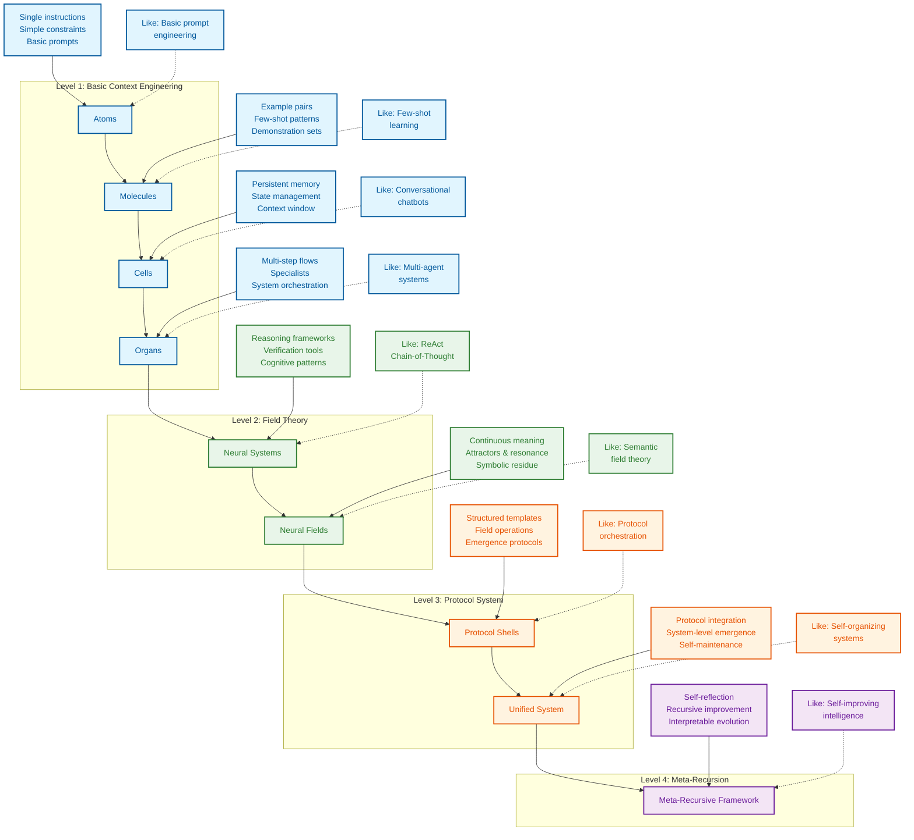

> 原文：[README.md](../README.md)
> 术语对照：[GLOSSARY.md](GLOSSARY.md) ｜ 阅读路径：[LEARNING_PATH.md](LEARNING_PATH.md)
<div align="center">
  
# 上下文工程（Context Engineering）

</div>


> **「上下文工程是一门精妙的技艺与科学：为下一步把恰到好处的信息填入上下文窗口。」—— [**Andrej Karpathy**](https://x.com/karpathy/status/1937902205765607626)**
>
> [**《软件正在改变（再次）》——@YC AI 创业学校演讲**](https://www.youtube.com/watch?v=LCEmiRjPEtQ)

<div align="center">
  
## [](https://deepwiki.com/davidkimai/Context-Engineering)


</div>

<div align="center">
  
 ## [DeepGraph](https://www.deepgraph.co/davidkimai/Context-Engineering)
 
## [用 NotebookLM 对话 + 播客深度解读](https://notebooklm.google.com/notebook/0c6e4dc6-9c30-4f53-8e1a-05cc9ff3bc7e)

## [](https://discord.gg/JeFENHNNNQ)


</div>

## [综合课程建设中](https://github.com/davidkimai/Context-Engineering/tree/main/00_COURSE)

> ### **[上下文工程综述——评阅 1400 篇研究论文](https://arxiv.org/pdf/2507.13334)**
>
> [**上下文工程精选资源库**](https://github.com/Meirtz/Awesome-Context-Engineering)

以第一性原理与可视化把上下文领域的最新研究落到实处——2025 年 7 月，来自 ICML、IBM、NeurIPS、OHBM 等会议与机构。


> **「为 GPT-4.1 提供『认知工具』后，它在 AIME2024 上的 pass@1 表现从 26.7% 提升到 43.3%，已非常接近 o1-preview 的表现。」** —— [**IBM Zurich**](https://www.arxiv.org/pdf/2506.12115)

<div align="center">
  
## [`智能体命令`](https://github.com/davidkimai/Context-Engineering/tree/main/.claude/commands)
**支持 [Claude Code](https://www.anthropic.com/claude-code) | [OpenCode](https://opencode.ai/) | [Amp](https://sourcegraph.com/amp) | [Kiro](https://kiro.dev/) | [Codex](https://openai.com/codex/) | [Gemini CLI](https://github.com/google-gemini/gemini-cli)**

#### [上下文工程综述——评阅 1400 篇研究论文](https://arxiv.org/pdf/2507.13334) | [上下文退化](https://research.trychroma.com/context-rot) | [IBM Zurich](https://www.arxiv.org/pdf/2506.12115) | [量子语义](https://arxiv.org/pdf/2506.10077) | [涌现符号学 ICML 普林斯顿](https://openreview.net/forum?id=y1SnRPDWx4) | [MEM1 新加坡-麻省理工](https://arxiv.org/pdf/2506.15841) | [LLM 吸引子 上海人工智能](https://arxiv.org/pdf/2502.15208?) | [MemOS 上海](https://github.com/MemTensor/MemOS) | [潜推理](https://arxiv.org/pdf/2507.06203) | [动态递归深度](https://arxiv.org/pdf/2507.10524)


</div>

一本前沿的第一性原理手册，带你超越提示词工程，进入上下文设计、编排与优化的广阔学科领域。


```
                    Prompt Engineering  │  Context Engineering
                       ↓                │            ↓                      
               "What you say"           │  "Everything else the model sees"
             (Single instruction)       │    (Examples, memory, retrieval,
                                        │     tools, state, control flow)
```
> 图：提示词工程与上下文工程的对比 —— Prompt Engineering / Context Engineering

## 上下文工程的定义

> **上下文并非用户发送给 LLM 的单一提示词。上下文是在推理时提供给 LLM 的完整信息载荷，涵盖模型为合理完成给定任务所需的全部结构化信息组件。**
>
> —— [**来自《对 1400 余篇研究论文的系统分析》的上下文工程定义**](https://arxiv.org/pdf/2507.13334)

```
╭─────────────────────────────────────────────────────────────╮
│              CONTEXT ENGINEERING MASTERY COURSE             │
│                    From Zero to Frontier                    │
╰─────────────────────────────────────────────────────────────╯
                          ▲
                          │
                 Mathematical Foundations
                  C = A(c₁, c₂, ..., cₙ)
                          │
                          ▼
┌─────────────┬──────────────┬──────────────┬─────────────────┐
│ FOUNDATIONS │ SYSTEM IMPL  │ INTEGRATION  │ FRONTIER        │
│ (Weeks 1-4) │ (Weeks 5-8)  │ (Weeks 9-10) │ (Weeks 11-12)   │
└─────┬───────┴──────┬───────┴──────┬───────┴─────────┬───────┘
      │              │              │                 │
      ▼              ▼              ▼                 ▼
┌─────────────┐ ┌──────────────┐ ┌──────────────┐ ┌──────────────┐
│ Math Models │ │ RAG Systems  │ │ Multi-Agent  │ │ Meta-Recurs  │
│ Components  │ │ Memory Arch  │ │ Orchestrat   │ │ Quantum Sem  │
│ Processing  │ │ Tool Integr  │ │ Field Theory │ │ Self-Improv  │
│ Management  │ │ Agent Systems│ │ Evaluation   │ │ Collaboration│
└─────────────┘ └──────────────┘ └──────────────┘ └──────────────┘
```
> 图：上下文工程精通课程路线图 —— Context Engineering Mastery Course / From Zero to Frontier


## 本仓库为何存在

> **「意义并非语义表达式内在的、静态的属性，而是一种涌现现象」—— [Agostino 等，2025 年 7 月，印第安纳大学](https://arxiv.org/pdf/2506.10077)**

提示词工程（prompt engineering）曾独占风头，但如今我们完全可以为下一步感到兴奋。一旦掌握了提示词，真正的力量来自于设计围绕这些提示词的**整个上下文窗口**。你不妨将其理解为一种引导思路的手段。

本仓库以生物隐喻为框架，提供了一条循序渐进、基于第一性原理的上下文工程路径：

```
atoms → molecules → cells → organs → neural systems → neural & semantic field theory 
  │        │         │         │             │                         │        
single    few-     memory +   multi-   cognitive tools +     context = fields +
prompt    shot     agents     agents   operating systems     persistence & resonance
```
> 图：从原子到场的演进隐喻 —— atoms → molecules → cells → organs → neural systems → neural & semantic field theory

> 「抽象是泛化的代价」—— [**Grant Sanderson（3Blue1Brown）**](https://www.3blue1brown.com/)


<div align="center">


*[上下文工程综述——2025 年 7 月](https://arxiv.org/pdf/2507.13334)*


  
 **[论涌现、吸引子与动力系统理论](https://content.csbs.utah.edu/~butner/systems/DynamicalSystemsIntro.html) | [哥伦比亚大学 DST](http://wordpress.ei.columbia.edu/ac4/about/our-approach/dynamical-systems-theory/)**


https://github.com/user-attachments/assets/9f046259-e5ec-4160-8ed0-41a608d8adf3


</div>




## 快速开始

1. **阅读 [`00_foundations/01_atoms_prompting.md`](00_foundations/01_atoms_prompting.md)**（5 分钟）  
   理解为何仅有提示词往往效果不佳

2. **运行 [`10_guides_zero_to_hero/01_min_prompt.py`](10_guides_zero_to_hero/01_min_prompt.py)**（Jupyter Notebook 风格） 
   用一个最小可运行示例动手实验


3. **浏览 [`20_templates/minimal_context.yaml`](20_templates/minimal_context.yaml)**  
   把模板复制粘贴到你自己的项目中  

4. **研究 [`30_examples/00_toy_chatbot/`](30_examples/00_toy_chatbot/)**  
   查看一个带有上下文管理的完整实现

## 学习路径

```
┌─────────────────┐     ┌──────────────────┐     ┌────────────────┐
│ 00_foundations/ │     │ 10_guides_zero_  │     │ 20_templates/  │
│                 │────▶│ to_one/          │────▶│                │
│ Theory & core   │     │ Hands-on         │     │ Copy-paste     │
│ concepts        │     │ walkthroughs     │     │ snippets       │
└─────────────────┘     └──────────────────┘     └────────────────┘
         │                                                │
         │                                                │
         ▼                                                ▼
┌─────────────────┐                             ┌────────────────┐
│ 40_reference/   │◀───────────────────────────▶│ 30_examples/   │
│                 │                             │                │
│ Deep dives &    │                             │ Real projects, │
│ eval cookbook   │                             │ progressively  │
└─────────────────┘                             │ complex        │
         ▲                                      └────────────────┘
         │                                                ▲
         │                                                │
         └────────────────────┐               ┌───────────┘
                              ▼               ▼
                         ┌─────────────────────┐
                         │ 50_contrib/         │
                         │                     │
                         │ Community           │
                         │ contributions       │
                         └─────────────────────┘
```
> 图：仓库学习路径 —— 00_foundations → 10_guides_zero_to_one → 20_templates → 30_examples → 40_reference → 50_contrib

## 你将学到什么

| 概念 | 是什么 | 为何重要 |
|---------|------------|----------------|
| **词元预算（Token Budget）** | 优化上下文中的每个词元 | 更多词元 = 更高开销与更慢的响应 |
| **少样本学习（Few-Shot Learning）** | 通过展示示例来教学 | 往往比单纯解释更有效 |
| **记忆系统（Memory Systems）** | 跨轮次持久化信息 | 实现有状态且连贯的交互 |
| **检索增强（Retrieval Augmentation）** | 找到并注入相关文档 | 以事实为回答的落地依据，减少幻觉 |
| **控制流（Control Flow）** | 将复杂任务拆分为步骤 | 用更简单的提示词解决更难的问题 |
| **上下文剪枝（Context Pruning）** | 移除无关信息 | 仅保留性能所需的内容 |
| **指标与评估（Metrics & Evaluation）** | 衡量上下文的有效性 | 在词元使用与质量之间迭代优化 |
| **认知工具与提示词编程（Cognitive Tools & Prompt Programming）** | 学习构建自定义工具与模板 | 提示词编程为上下文工程开启新的层次 |
| **神经场论（Neural Field Theory）** | 将上下文视为神经场 | 将上下文建模为动态神经场，可实现迭代式上下文更新 |
| **符号机制（Symbolic Mechanisms）** | 符号架构支持高阶推理 | 更智能的系统 = 更少的工作量 |
| **量子语义（Quantum Semantics）** | 意义依赖于观察者 | 利用叠加技术设计上下文系统 |


## Karpathy + 3Blue1Brown 启发的风格

> 面向各种经验水平的学习者

1. **第一性原理** —— 从最基础的上下文开始
2. **迭代增量** —— 只添加模型确实缺少的内容
3. **衡量一切** —— 词元成本、延迟、质量分数
4. **果断删除** —— 剪枝胜过填充
5. **代码 > 幻灯片** —— 每个概念都有可运行的单元
6. **可视化一切** —— 每个概念都用 ASCII 与符号图示来呈现

# 研究证据 
## 记忆 + 推理

### **[MEM1：学习协同记忆与推理，打造高效长时程智能体——新加坡-麻省理工，2025 年 6 月](https://www.arxiv.org/pdf/2506.15841)**

> 「我们的结果表明，以推理驱动的记忆巩固有望成为训练长时程交互式智能体的现有方案的可扩展替代方案，同时兼顾效率与性能。」—— [新加坡-麻省理工](https://arxiv.org/pdf/2506.15841)


1. **MEM1 训练 AI 智能体只保留重要的内容——在每一步融合记忆与推理——这样无论任务多长，它们都不会被压垮。**

2. **MEM1 不再堆积无休止的上下文，而是把每次交互压缩成紧凑的『内部状态』，就像一张会更新而非重抄的聪明笔记。**

3. **通过把记忆与思考融合为单一流程，MEM1 学会只记住要点——让智能体更快、更敏锐，并能处理长得多的对话。**

4. **智能体所做的一切都被打上标签并结构化，因此每个动作、问题或事实都清晰且易于审计——不再有来路不明的记忆。**

5. **每个循环都会剪掉旧的杂乱内容，只保留最新、最相关的洞见继续向前，正如专家解题者会提炼自己的笔记。**

6. **MEM1 证明，递归的、由协议驱动的记忆——不断精炼与整合——在速度与准确性上都优于传统的『只要多加上下文』方案。**
## 认知工具

### **[用认知工具激发语言模型中的推理——IBM Zurich，2025 年 6 月](https://www.arxiv.org/pdf/2506.12115)**

### 作为推理工具调用的提示词与提示词程序
> 「认知工具」把推理操作封装在 LLM 内部 —— [IBM Zurich](https://www.arxiv.org/pdf/2506.12115)


> **这些认知工具（作为工具调用的结构化提示词模板）通过识别当前的主要问题概念、提取问题中的相关信息，并突出可能有助解题的有意义属性、定理与技巧，来拆解问题。**


> **这些模板为推理层提供支架，类似于认知心理捷径，通常被称为『启发式方法』。**

1. **这项研究表明，把复杂任务拆解为模块化的『认知工具』，能让 AI 更有条理地解决问题——正如专家级人类会一步步推理。**

2. **模型不再依赖一个庞大提示词，而是调用专门的提示词模板，即认知工具，如『理解问题』『回忆相关』『检查答案』与『回溯』——各司其职，处理不同的心理操作。**

3. **认知工具就像内在的心理捷径：AI 在每个阶段选择合适的程序并运行它，在执行任务前先规划推理与后续动作，以获得更高的准确性与灵活性。**

4. **通过把推理步骤分装进模块化块中，这些工具可防止混淆、减少错误，并让模型的思维过程透明且可审计——即使面对高难度数学题也是如此。**

5. **这种模块化方法同时提升开源与闭源模型的表现——在不额外训练的情况下，增强真实世界数学解题能力，逼近经过 RL 训练的先进『推理』模型。**

6. **结果表明，强大推理的种子早已存在于大型语言模型内部——认知工具只是解锁并编排这些能力，提供了一种透明、高效且可解释的替代方案，来代替黑箱式调优。**
## 涌现的符号

## **[涌现的符号机制支持大型语言模型中的抽象推理——ICML 普林斯顿，2025 年 6 月 18 日](https://openreview.net/forum?id=y1SnRPDWx4)**


> **TL;DR：研究发现一种三阶段架构，通过一组涌现的符号处理机制支持 LLM 的抽象推理。**
>
>


**这些机制包括符号归纳头、符号抽象头与检索头。**

**1. 在早期层，符号抽象头根据词元之间的关系把输入词元转换为抽象变量。**

**2. 在中间层，符号归纳头对这些抽象变量执行序列归纳。**

**3. 最后，在后期层，检索头通过检索与预测抽象变量关联的值来预测下一个词元。**

**这些结果指向一场长期争论的解决：符号方法与神经网络方法之争，表明神经网络中的涌现推理依赖于符号机制的涌现。** —— [**ICML Princeton**](https://openreview.net/forum?id=y1SnRPDWx4) 


>
> **为何有用？**
>
>
> **这解释了为何 Markdown、Json 等类似的结构化符号格式更容易被 LLM 解析**
>
> **概念：与智能体协作，运用分隔符、语法、符号、符号词、隐喻和结构，以在推理过程中改善推理／上下文／记忆／持久性**

1. **本文证明，大型语言模型会发展出自己内在的符号『逻辑电路』——使它们能用抽象变量推理，而不只是停留在表层词语模式上。**

2. **LLM 呈现出三阶段过程：先从输入中抽象出符号，再对这些变量进行推理，最后把抽象答案映射回真实世界的词元。**

3. **这些涌现机制意味着 LLM 并不只是记忆——它们实际上创建出内部且灵活的表征，使其能泛化到新问题和类比上。**

4. **早期层的注意力头像『符号提取器』，中间层执行符号推理，后期层检索具体答案——映照出人类式的抽象与检索。**

5. **通过针对性的实验与干预，作者表明这些符号过程对抽象推理既必要又充分，且跨多个模型与任务均成立。**

6. **研究结果弥合了符号 AI 与神经网络之间的历史鸿沟——表明在足够规模下，神经网络能够发明并使用符号机制，从而支持真正的泛化与推理。**


## 星标历史

[](https://www.star-history.com/#davidkimai/Context-Engineering&Date)

## 贡献

欢迎贡献！请查阅 [CONTRIBUTING.md](.github/CONTRIBUTING.md) 了解指南。

## 许可证

[MIT 许可证](LICENSE)

## 引用

```bibtex
@misc{context-engineering,
  author = {Context Engineering Contributors},
  title = {Context Engineering: Beyond Prompt Engineering},
  year = {2025},
  publisher = {GitHub},
  url = {https://github.com/davidkimai/context-engineering}
}
```

## 致谢
> 我一直期待这个概念被形式化，因为此前并没有一个已确立的领域。提示词工程颇受污名化，也无法涵盖大多数研究者以及我所做的工作。

- [Andrej Karpathy](https://x.com/karpathy/status/1937902205765607626) 提出了「上下文工程」一词，并启发了本仓库 
- 所有贡献者与开源社区
